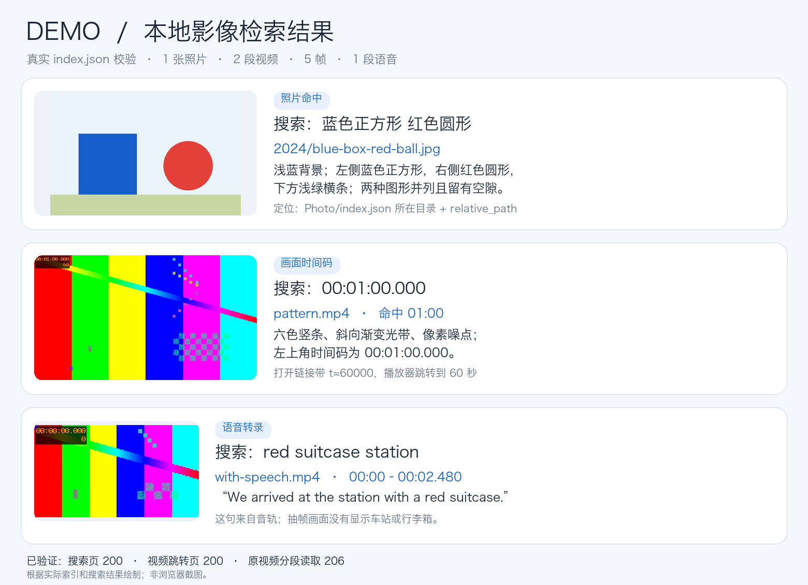

# Demo 实跑结果



这份 demo 只使用项目自带的合成素材，没有处理个人照片或视频。`Photo/index.json` 和 `Video/index.json` 已由项目脚本及本机模型生成。项目迁移到 `~/photo_video_index` 后再次运行完整扫描，1 张照片与 2 段视频均判定为未变化并跳过，因此保留此前由本地视觉模型和语音模型生成的内容。公开样例已清空 `source_root_hint`，避免提交本机绝对路径；在自己的电脑上重新建索引时会更新该提示。当前自动化执行环境不能访问 Metal GPU，故本次没有重新做模型推理；索引、检索、路径和页面请求均已重新验证。

## 处理了什么

| 素材 | 索引内的结果 | 原始资料 |
| --- | --- | --- |
| [蓝色方块和红色圆形照片](demo/Photo/2024/blue-box-red-ball.jpg) | `Photo/index.json` 内 1 条照片记录 | 照片原件保持在 `Photo/2024/` |
| [65 秒测试视频](demo/Video/pattern.mp4) | `Video/index.json` 内 1 条视频记录，0、30、60 秒共 3 帧 | `Video/Resources/pattern.mp4/frames/` |
| [35 秒带语音视频](demo/Video/with-speech.mp4) | `Video/index.json` 内 1 条视频记录，0、30 秒共 2 帧，1 段语音 | `Video/Resources/with-speech.mp4/` 中的帧、`audio.wav`、`transcript.json` 和 `transcript.srt` |

两个索引共生成 3 条媒体记录、5 条抽帧描述、1 条语音转录与 5 条画面和语音的时间窗记录。检索器从它们展开了 14 个可检索命中单元。

## 索引里的实际内容

照片的 `relative_path` 是 `2024/blue-box-red-ball.jpg`。模型描述摘要为：“一张极简风格的平面图形，浅蓝背景上左侧为蓝色正方形，右侧为红色圆形，底部有浅绿横条。”详情还记录了两种图形并列、中间留有空隙、没有可辨文字。模型同时声称红圆底部与绿色横条相接；查看原图可见两者之间有空隙，这是一个具体的识别错误，说明生成后仍需抽查。打开原件时，脚本用 **`Photo/index.json` 的父目录 + `relative_path`** 得到照片路径。

`pattern.mp4` 的帧记录如下；每条都含完整的 `summary`、`description`、物体、空间关系、标签、OCR 和不确定性说明：

| `at_ms` | 时间 | 索引摘要 |
| ---: | --- | --- |
| `0` | 00:00 | 六色竖条、左上计时器、中部斜向渐变光带和右侧噪点 |
| `30000` | 00:30 | 彩色竖条、斜向渐变条、左上时间码和右侧像素干扰 |
| `60000` | 01:00 | 六色竖条、斜向光带、像素噪点和 `00:01:00.000` 时间码 |

`with-speech.mp4` 的转录片段为 `start_ms=0`、`end_ms=2480`、`text="We arrived at the station with a red suitcase."`。0 秒的合并时间窗同时保存抽帧画面描述和这句音轨文字，并注明**仅凭抽帧不能确认说话人**。车站和红色行李箱来自声音，不能当作画面中可见的物体。

## 实际搜索与定位

以下命令使用现有索引即可复现，不需再次调用模型：

```bash
cd ~/photo_video_index
./.venv/bin/python media_index.py search \
  --index demo/Photo/index.json --index demo/Video/index.json \
  --no-semantic --query '蓝色正方形 红色圆形'
./.venv/bin/python media_index.py search \
  --index demo/Photo/index.json --index demo/Video/index.json \
  --no-semantic --query 'red suitcase station'
./.venv/bin/python media_index.py search \
  --index demo/Photo/index.json --index demo/Video/index.json \
  --no-semantic --query '00:01:00.000'
```

这三次查询的首位结果分别为：

1. `蓝色正方形 红色圆形` → `Photo/2024/blue-box-red-ball.jpg`，来源 `photo`。
2. `red suitcase station` → `Video/with-speech.mp4`，来源 `speech`，命中 `00:00:00.000`；原转录覆盖 `0–2480 ms`。
3. `00:01:00.000` → `Video/pattern.mp4`，来源 `frame`，命中 `00:01:00.000`。

本机搜索服务启动后，第三个结果的打开地址形如：

```text
http://127.0.0.1:8765/view?lib=video-6d60447daf554a9f&path=pattern.mp4&t=60000
```

其中 `path=pattern.mp4` 仍由 `Video/index.json` 的父目录解析到原件；`t=60000` 让播放页跳到 60 秒。这个 `127.0.0.1` 地址只在启动搜索服务的那台电脑上有效。移动项目文件夹后，相对路径定位仍成立；若仅复制 JSON 而没带原媒体，应为该库设置可访问的 `--media-root`。

## 本次验证记录

- 完整索引命令报告：照片 `1/1`、视频 `2/2`，全部“跳过未变化”；索引只更新了迁移后的根目录提示，媒体描述保持不变。
- 路径解析检查：3 条媒体记录均通过各自索引的父目录和 `relative_path` 找到真实文件。
- 搜索检查：上述 3 个查询的首位结果、类型与时间码均符合预期。
- 搜索页面实际 HTTP 请求：结果页返回 `200`，带 `t=30000` 的视频播放页返回 `200` 且包含 `currentTime=30.0`，视频字节区间请求返回 `206`。服务已在验证后关闭。

结果图是依据实际索引与搜索输出绘制的静态图，**不是浏览器截图**。30 秒抽帧可能漏掉短暂画面；模型对低分辨率测试画面的细节可能有误判，使用真实资料前应抽查索引内容。
