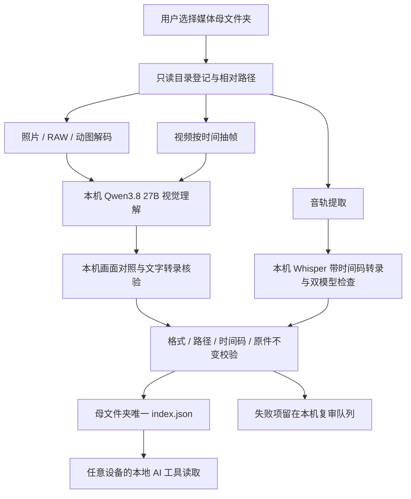

# 架构与文件说明

本项目把本机媒体转换成一份可携带的文字索引。程序、模型和运行缓存属于项目工作区；原始媒体与 `index.json` 属于用户明确选择的资料库。

| 文件 | 职责 |
| --- | --- |
| `setup.command` / `setup.sh` | Apple Silicon 硬件检查与项目内 Python 环境安装 |
| `install_local.py` / `model-manifest.json` | 下载、恢复、校验模型与 OpenCode，生成本机配置并自测 |
| `requirements-mlx.txt` / `.lock` | 实测运行版本与完整依赖哈希 |
| `library-local` / `media_library.py` | 显式选择根目录、登记、分批处理、保存和状态 |
| `single_library.py` | schema 2 混合目录索引、稳定 ID、相对链接、增量合并 |
| `media_decode.py` | 原件只读解码，RAW、HEIC、方向、色彩与 EXIF 移除 |
| `native_frames.py` | AVFoundation 色彩管理、HDR 转 SDR 与实际解码时间 |
| `index_pipeline.py` | 每项校验、断点缓存、动态图与视频时间序列 |
| `grounded_index.py` / `local_ocr.py` / `speech_quality.py` | 本机视觉描述、独立复核与逐字 OCR，保留不确定性 |
| `media_index.py` | 通用媒体/转录/索引工具与旧格式兼容 |
| `local_runtime.py` / `opencode-local` | 项目隔离环境与仅回环网络的进程沙箱 |
| `quality-release.json` | 真实样本监督的全库放行状态 |
| `.models/`、`.venv-mlx/`、`.local/`、本机配置 | 仅在本机生成，不进入公开仓库 |

原件定位规则是“索引所在目录 + `relative_path`”。`library_id` 为随机稳定标识，不包含个人路径；文件变更检测使用大小、修改时间，处理时另检查 SHA-256。原件处理前后校验失败时拒收结果。索引通过同目录临时文件、同步和原子替换写入，上一版备份在项目 `.local/`。

视频的 `frames[].at_ms`、`transcript[].start_ms/end_ms` 和 `moments[]` 保留证据时间。摘要采用分组再合并，避免长视频尾部因简单截断被丢掉。`complete` 表示既定采样和转录流程完成，并不表示逐帧看过或每个事件均被捕获。

模型下载需要联网；正式处理使用下载好的本机权重与回环服务。OpenCode 只是受限的工作流调用者，不负责把媒体交给云端。当前没有自动 NAS/云同步，也没有 Apple Intelligence 集成；用户可自行选择能读取该索引的本地工具。

旧 schema 1 每 Photo/Video 文件夹一份索引的工具保留兼容。新版本默认只生成母文件夹的一份 schema 2 索引，不沿用旧安装器的 Ollama 或跨平台降级方案。

## 检索名词与实际状态

- **关键字检索**：按索引文字匹配词语。旧命令与旧网页保留此类工具，中文拆字可能造成误命中，不能据此宣称能理解任意自然语言查询。
- **语义检索**：通过向量或其他语义模型寻找含义相近的内容；本版本未实现、未验证专门的语义检索服务。
- **RAG**：先检索证据，再交给生成模型组织回答；本版本未实现、未验证 RAG 问答。

当前交付与质量验证针对单一索引文件的内容、路径、时间码与处理状态。用户可以在其他本地 AI 工具中自行建立 agentic search 或 RAG；这不代表项目已经与该工具集成。

视频视觉输入通过本机 AVFoundation 强制 SDR，再转 sRGB，记录实际帧时间；不使用色彩未经转换的 HDR 抽帧作为颜色证据。对无法解码、文字不一致或声音不可靠的结果明确保留复审状态。

对已识别的 360° 或明显变形全景，使用独立复核的物体类别，省略人物去重、人数、姿态和属性分配；普通画面的远处小人物也不写无依据的精细动作。

`local_ocr.py` 另提供只返回区域数量与最大面积的人脸区域检测，用于多人近景的保守分支，不做人脸身份识别或特征向量。该分支仍由 MLX-VLM 理解环境和核对配件，个人属性与物体间关系留空，避免把头发或旁人的衣服归给被遮挡的人。

`moments.start_ms/end_ms` 表示采样周边的检索窗口；视觉链接使用 `frame_at_ms`，避免把窗口起点误当成证据画面。只有语音而没有画面证据的窗口使用语音起点。
