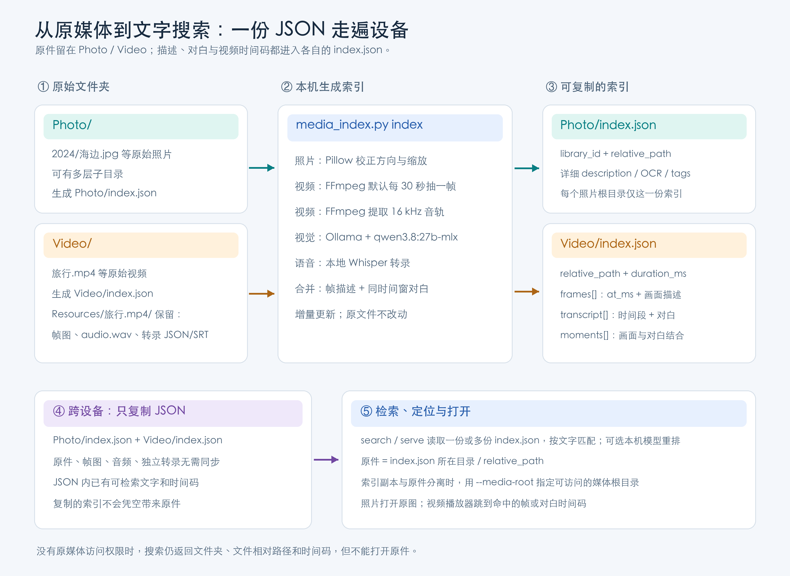

# Photo / Video 本地索引：配置与项目结构

这份说明对应 `~/photo_video_index/` 中的可运行项目。相应平台的安装脚本在新电脑上准备环境，`config.json` 保存这台电脑的处理参数，`media_index.py` 负责建索引与检索。照片、视频可以放在项目目录以外；每个 `Photo/` 或 `Video/` 根目录各生成一份 `index.json`。




这两张图也有可编辑的 [SVG 源文件](docs/项目结构.svg) 和 [数据流程 SVG](docs/数据流程.svg)。

## 1. 文件各自做什么

| 位置 | 用途 | 是否跨电脑复制 |
| --- | --- | --- |
| `media_index.py` | 扫描媒体、调用本地模型、写索引；提供命令行搜索和本机网页搜索 | 安装项目时复制 |
| `config.example.json` | 不含个人路径的可用配置模板 | 安装项目时复制 |
| `config.json` | `setup.command` 从模板生成的本机配置；可以手动改 | 按新电脑调整，不必与媒体索引同步 |
| `.setup-model-state.json` | 记录安装器上次自动选择的视觉模型，以便整项目迁移后按新硬件重选并保留用户手改的模型 | 整项目迁移时复制；不属于媒体索引 |
| `setup.command` | Mac Finder 可双击的安装入口，调用 `setup.sh` | 安装项目时复制 |
| `setup.sh`、`setup.cmd`、`setup.ps1`、`setup_support.py` | macOS/Linux、Windows 的实际安装逻辑及平台检测、配置辅助逻辑 | 安装项目时复制 |
| `requirements-common.txt`、`requirements-macos-arm64.txt`、`requirements-portable.txt` | 锁定通用图片/视频依赖，以及不同平台的语音后端版本 | 安装项目时复制 |
| `试跑.command` | 在 Mac 上选择照片、视频文件夹，少量处理并打开搜索页 | 安装项目时复制 |
| `README.md` | 最短的操作入口 | 安装项目时复制 |
| `DEMO_RESULTS.md` | 非私人样例的实际运行结果和已知识别误差 | 安装项目时复制 |
| `docs/` | 本说明里的 SVG、PNG 结构图 | 安装项目时复制 |
| `tests/` | 路径安全、索引和搜索的自动检查 | 安装项目时复制 |
| `demo/Photo`、`demo/Video` | 可公开查看的样例原件与索引 | 可选；用于安装后试跑 |
| `.venv/` | 安装器为当前电脑建立的 Python 环境 | 不复制；在新电脑重新运行安装器 |
| `Photo/index.json`、`Video/index.json` | 各资料库的**完整可检索文字索引** | **跨设备检索时只需复制这两类文件** |
| `Video/Resources/<视频相对路径及完整文件名>/` | 抽取的帧、音轨、独立转录 JSON/SRT | 留在原视频资料库，不是跨设备检索依赖 |

`Photo/`、`Video/` 是你选择的媒体根目录名称，示意图中与项目并列。它们可以分别位于其他硬盘或 NAS。`index.json` 必须放在它对应的媒体根目录；嵌套媒体文件通过 `relative_path` 表示，例如 `2024/海边.jpg`。

安装入口按系统选择：Mac 双击 `setup.command`；Linux 在项目目录运行 `bash setup.sh`；Windows 双击 `setup.cmd`。安装器检测内存容量后挑选视觉模型；整项目迁移时，原本由安装器自动选择的模型会按新硬件重选，你手动改过的模型保持不变。当前自动安装的目标平台是 Apple Silicon/Intel Mac、Linux x86_64/ARM64 和 Windows x64；机器需要网络来下载安装器、包和模型。

## 2. config.json：一台电脑的处理设置

第一次安装后，安装器将 `config.example.json` 复制或调整为 `config.json`。模板是有效 JSON，里面没有你的媒体绝对路径。媒体文件夹在运行时选择或通过 `--photo-root`、`--video-root` 指定；同一配置可处理多组资料库。`media_index.py` 默认读取项目目录中的 `config.json`；显式命令行参数可以临时覆盖对应配置，也可以用 `--config /路径/其他配置.json` 指定另一份。下表中的数值是模板值。

| 字段 | 模板值 | 作用 |
| --- | --- | --- |
| `schema_version` | `1` | 配置格式版本；避免误读未知格式。 |
| `vision_model` | `qwen3.8:27b-mlx` | Ollama 使用的图像理解模型；当前机器选用此标签。 |
| `ollama_url` | `http://127.0.0.1:11434` | 本机 Ollama 服务地址。保持回环地址时，图像和文字只发到本机模型服务。 |
| `timeout_seconds` | `300` | 单次视觉或文本模型调用的超时秒数。 |
| `frame_interval_seconds` | `30` | 视频从 0 秒起每隔多少秒抽一帧；降低到 `10` 可捕捉更多短暂画面，但时间和索引体积上升。 |
| `max_frames` | `0` | 每视频最多分析的帧数；`0` 表示不截断。试跑时可临时设为 `3`，索引会标明 `partial`。 |
| `checkpoint_every` | `25` | 每成功处理多少个文件先落盘一次，便于长批次中断后续跑。 |
| `asr_backend` | `auto` | 自动选择当前平台可用的本地 Whisper 转录实现；还可显式指定后端。 |
| `mlx_asr_model` | `mlx-community/whisper-small-mlx` | Apple Silicon 上的 MLX Whisper 模型来源。首次使用要下载权重。 |
| `faster_whisper_model` | `small` | 非 MLX 路径使用的 Whisper 模型大小/名称；首次使用要下载权重。 |
| `silence_threshold_db` | `-55.0` | 丢弃落在近乎数字静音片段上的误转录。 |
| `search_port` | `8765` | 本机浏览器搜索页使用的端口；服务只监听 `127.0.0.1`。 |
| `semantic_search` | `true` | 搜索时是否让 Ollama 扩展同义表达并重排候选；关闭后只做本地文字匹配。 |

配置中的 `max_frames: 0` 是完整扫描的默认值。`试跑.command` 为节约试验时间，只取每类第一个文件、每视频最多 3 帧；正式建立资料库索引时运行完整扫描。修改模型、抽帧间隔、转录设置后重新运行，相关条目会按处理签名更新。

首次安装时的模型选择按物理内存分层；已有 `config.json` 不会被覆盖。以下标签均在 [Ollama 官方模型目录](https://ollama.com/library/qwen3.5/tags)或 [Qwen3.8 目录](https://ollama.com/library/qwen3.8/tags)中列出：

| 安装器检测到的内存 | Apple Silicon | Intel Mac / Linux / Windows | 说明 |
| --- | --- | --- | --- |
| ≥31 GiB（约 32 GB 档） | `qwen3.8:27b-mlx` | `qwen3.8:27b` | 高细节档；模型文件约 18 GB。 |
| ≥15 且 <31 GiB（约 16 GB 档） | `qwen3.5:9b-mlx` | `qwen3.5:9b` | 中等档，视觉细节可能少于 27B。 |
| ≥7 且 <15 GiB（约 8 GB 档） | `qwen3.5:4b-mlx` | `qwen3.5:4b` | 轻量档；建议人工复核描述与 OCR。 |

上述阈值是安装器的实用选择规则，不保证所有新电脑在默认条件下达到相同速度或图像识别质量。检测到的物理内存低于 7 GiB 时，安装器会停止并解释原因。

## 3. 运行依赖与版本

下表的版本是 **2026-09-28 这台 Mac 的已验证环境快照**，不是所有平台都必须固定在相同补丁号。新电脑的安装器应建立独立环境，避免改动系统 Python。

| 组件 | 本机版本或模型 | 为什么需要 | 运行位置 |
| --- | --- | --- | --- |
| Python | 3.12.14 | 运行 `media_index.py`；网页服务与 JSON 处理使用 Python 标准库。 | `.venv` |
| uv | 0.12.19 | 创建环境并安装 Python 包。 | 安装时使用 |
| Pillow | 12.3.0 | 照片解码、EXIF 方向校正、透明背景合成和临时缩放。 | `.venv` |
| imageio-ffmpeg | 0.6.0 | 提供 FFmpeg 二进制，执行视频抽帧和 16 kHz 单声道音轨提取。 | `.venv` |
| mlx-whisper | 0.4.3 | Apple Silicon 上本地运行 Whisper 语音转录。 | `.venv`，有音轨的视频才需要 |
| faster-whisper | 1.2.1（便携安装分支） | Intel Mac、Linux、Windows 的本地 Whisper 语音转录后端。 | `.venv`，有音轨的视频才需要 |
| MLX | 0.32.2 | `mlx-whisper` 的 Apple Silicon 推理框架。 | `.venv` 的传递依赖 |
| Ollama | 客户端 0.34.4 | 运行本机视觉模型；可选辅助文字搜索。 | 独立本机服务 |
| 视觉模型 | `qwen3.8:27b-mlx`，下载约 18 GB | 为照片与每个视频帧生成具体中文描述、对象、空间关系、标签和可辨认文字。 | Ollama 模型库 |
| 语音模型 | `mlx-community/whisper-small-mlx` | 将视频音轨转为带时间戳的文字段。 | 本机模型缓存 |
| FFprobe | 可选 | 若系统提供，可更准确读取视频时长和有无音轨；否则程序用 FFmpeg 探测。 | 系统命令 |
| whisper.cpp | 可选 | 已有 `whisper-cli` 与 GGML 模型的用户可手动选用。 | 系统命令 |
| `sips`、`osascript` | macOS 自带 | `sips` 是 HEIC 解码的备用路径；`osascript` 用于双击试跑时选文件夹。 | macOS |

`faster-whisper` 是 Linux、Windows 和 Intel Mac 的本地转录路径：安装器会按平台安装它，配置中的 `faster_whisper_model` 控制模型大小。Apple Silicon 上默认优先使用 MLX。模型下载和包安装需要网络；下载完成后，本机 `ollama_url` 与本地语音后端可以离线处理资料。[Ollama 的模型页面](https://ollama.com/library/qwen3.8%3A27b-mlx)将 `qwen3.8:27b-mlx` 标为约 18 GB；考虑模型加载、图像处理与系统开销，本项目建议至少 32 GB 统一内存使用这个 27B 配置。低内存新电脑应在安装时选择较小的视觉模型；安装器会据机器平台与容量调整 `config.json`。

**当前项目是本地脚本和本机网页搜索。** `semantic_search` 使用本机 Ollama，不会自动调用云模型或 Siri；若要让 Siri 直接查询索引，需要额外的快捷指令桥接。安装器只负责把这套现有功能准备好。

## 4. 一次建索引时发生什么

1. 程序递归扫描选中的 `Photo/` 或 `Video/`。`Video/Resources/` 不作为原视频再次扫描；隐藏文件夹也跳过。每个文件的 `relative_path` 相对于同目录的 `index.json` 所在根目录计算。
2. 照片经 Pillow 校正方向、压到最长边约 1600 像素后作为**临时模型输入**；原件不改。Ollama 输出 `summary`、详细 `description`、`objects`、`spatial_relations`、`tags`、`ocr_text` 和不确定性说明。
3. 视频每隔 `frame_interval_seconds` 抽帧；每帧走相同的视觉描述流程。视频有音轨时，FFmpeg 提取音频，Whisper 输出带 `start_ms`、`end_ms` 的语音段。程序把同时间窗的视觉和对白写入 `moments[]`，并生成视频摘要。原始帧、音轨及独立转录存入该视频对应的 `Resources/` 子目录。
4. 所有搜索必需信息写入这个资料库的单个 `index.json`。相同原件及处理设置再次运行时跳过；完整扫描可识别移动/更名和删除。索引写入采用临时文件替换；处理中断会保留已完成进度并标记未完成。

视频固定间隔抽帧无法保证捕获两帧之间短暂出现的物体。文字描述和转录也可能有错；正式处理前，先检查少量样例的 `description`、`ocr_text`、时间码与原画面。

## 5. 检索如何找到原文件

一个索引条目的定位键是 `library_id + relative_path`。若索引与原件同处一个资料库，则：

```text
原件路径 = index.json 所在目录 / relative_path
例：/盘/Photo/index.json + 2024/海边.jpg
  → /盘/Photo/2024/海边.jpg
```

程序拒绝绝对路径、`..`、空路径段，以及越过媒体根目录的符号链接。搜索读取一份或多份索引；照片命中打开原图，视频命中根据帧或语音段时间码在本机浏览器定位。

当另一台电脑**只复制了 `index.json`**，索引副本的父目录不含原件。这时搜索仍返回 `library_id`、`relative_path` 和视频时间码；需要让该电脑访问原媒体文件夹，再以 `--media-root 'library_id=/已挂载的/Photo或Video'` 指定一个媒体根目录。路径后半段仍然是原索引里的同一条 `relative_path`，不用重新生成另一套按设备写死的索引。没有原件访问权限时，页面不会生成一个打不开的“原件链接”。

## 6. 最短操作入口

下面是 Mac 终端命令；Finder 中可以先双击 `setup.command`，再双击 `试跑.command`。Linux 用 `bash setup.sh` 安装；Windows 双击 `setup.cmd` 安装。两种系统完成安装后也可使用对应 `.venv` 的 Python 运行相同的 `media_index.py` 子命令。

```bash
cd ~/photo_video_index
zsh setup.command
./.venv/bin/python media_index.py doctor
./.venv/bin/python media_index.py index --photo-root "/你的/Photo" --video-root "/你的/Video"
./.venv/bin/python media_index.py serve --index "/你的/Photo/index.json" --index "/你的/Video/index.json" --open-browser
```

Mac 上也可双击 `试跑.command`：它先少量处理选中的真实文件，再打开本机搜索页。`demo/` 中另有非私人样例，可用于安装后的验证；详见 [README.md](README.md)。
